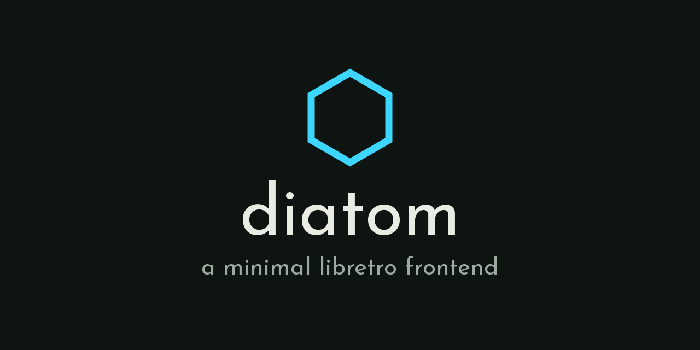

  

A minimal libretro frontend for low-power ARM Linux handhelds (~1GB RAM). It is
the emulator behind [TortOS](https://github.com/ericreinsmidt/TortOS), which
drives it over a Unix socket, and a permissively licensed base for any other
firmware that wants one.

**Mozilla Public License 2.0** ([LICENSE](LICENSE)). Diatom's own files stay
open: whoever changes them and shares the result shares their changes too. But
the license stops at Diatom's files, so Diatom can still host cores under any
license - which is what `libretro.h` is permissive for - and it loads whatever
core it is handed and ships none of them. It was MIT until 2026-10-25.

**Status: running on hardware, shipping in TortOS.** Eleven systems across six
cores on a TrimUI Brick (TG3040): NES · SNES · Genesis · Master System ·
Game Gear · Game Boy · Game Boy Color · GBA · PC Engine (HuCard and CD) ·
Neo Geo Pocket · Neo Geo Pocket Color. All 2D, all digital input, all light
enough to keep every core resident at once. Five of the cores are pinned and
measured here ([CORES.md](CORES.md)); the sixth, `mednafen_ngp` for the two
Pocket systems, is pinned by TortOS and not yet measured here.

    diatom --core snes9x2010_libretro.so --rom parodius.sfc

Standalone is the primary mode. A launcher driving a resident diatom over a
Unix socket is an
additional mode, not the fundamental one - designing for a program that stands
alone is a stricter test than designing for one embedder.

---

## Building

    make                        desktop (SDL2), for iteration
    make check                  the checks below; run before committing

The devices' builds are [plastron](https://github.com/ericreinsmidt/plastron)'s:
its Buildroot builds Diatom for the TrimUI Brick and the GKD Pixel 2 with its
own compiler and SDL2 (`PORT=brick` or `PORT=pixel2`, SDL2 found with
pkg-config), from this working tree.

`make check` is not advice. It fails on a port including `libretro.h`,
on documented core measurements describing binaries the
project no longer ships, on any sample rate stated as current truth that the
generated core facts do not record, on a RetroAchievements address failing to
reach the byte it names, on the launcher protocol not reaching the socket, on
the launcher state plane end to end against the stub core, and on the port's
audio contract. Each of those exists because the rule it guards decayed the
moment nothing failed when it was broken.

One suite sits outside it because it needs a build, and is named here so it
does not quietly stop being run:

    make conform-check          determinism, RSS, allocations (~20s, no device)

`conform` is where the memory claims stop being claims: the frame loop
**allocates nothing** (the count is identical at N and 2N frames). Measured on
a Brick, diatom peaks at **8.2 to 8.4 MB** with FCEUmm running.

## Layout

| Path | What it is |
|---|---|
| `src/` | The host: core loading, environment callbacks, frame loop, resampling, saves, the launcher protocol, volume and brightness |
| `port/` | Per-device backends. `desktop` (SDL2), `brick` (raw fbdev) and `pixel2` (GLES on KMS). Pixels, samples, buttons, time, and the hardware under the levels - nothing else |
| `include/diatom_port.h` | The one load-bearing seam, and the rules that keep it honest |
| `test/stubcore.c` | A libretro core that is not an emulator, so the frontend can be exercised with no third-party binary |
| `tools/` | The checks, and the allocation counter `conform` links in |
| `test/` | The stub core, and the suites that exercise the frontend against it |
| `docs/reference/core-facts.md` | What the shipped cores actually report, measured on the device rather than transcribed |
